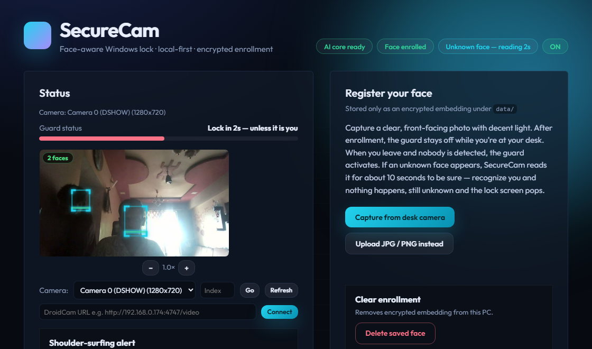
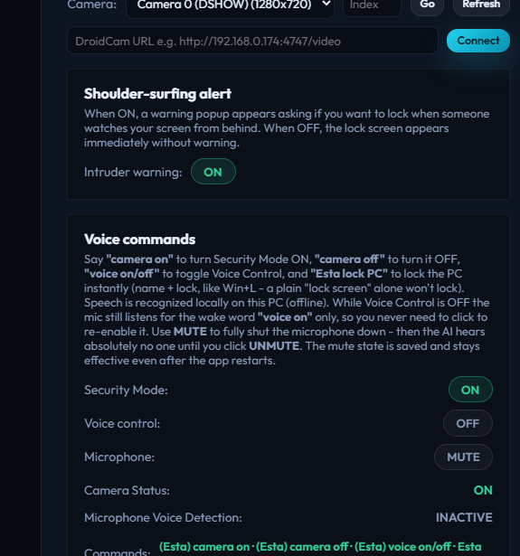

# CAMER SECURE SYSTEM

> Your AI desk guard — face-recognition security, stranger auto-lock, offline voice control, and a live animated camera preview.

🌐 **Live website (download + full setup guide):**
**https://khanhishan70-stack.github.io/CAMER-SECURE-SYSTEM/**

⬇️ **Direct download (Windows):**
**https://github.com/khanhishan70-stack/CAMER-SECURE-SYSTEM/releases/download/v1.0.0/CAMER-SECURE-SYSTEM-Windows.zip**



## What it does

- **Face guard** — enroll your face once; the app knows when *you* are at the desk.
- **Stranger auto-lock** — an unknown face is read for 5 seconds; if it never matches you, the screen locks and Ava says *"Sorry, you are not the owner of this system"* (once per lock).
- **Animated face tracking** — every face gets a glowing box with a sweeping scanline + live face counter on the preview.
- **Offline voice control** — say *"camera on / camera off"*, *"voice on / voice off"*, *"Esta lock PC"* (real Win+L). 100% on-device, nothing leaves your PC.
- **Mic MUTE** — fully shuts the microphone down (not even the wake word listens). Saved permanently until you unmute.
- **Guard announcements** — *"Guard active."* when you leave the desk, *"Welcome back"* when you return.
- **Shoulder-surfing alert + intruder warning** popups.

## Setup (normal users — 5 minutes)

1. **Download** the zip above and extract it anywhere.
2. Install **Python 3.12** (Windows installer, tick *Add to PATH*).
3. Open Command Prompt **in the extracted folder** and install the brain:
   ```bat
   "C:\Program Files\Python312\python.exe" -m pip install -r requirements.txt
   ```
   The face-AI model (~300 MB) downloads itself on first start. The voice model is already in the zip.
4. Double-click **`SecureCam.exe`**. The app opens — done.

Then inside the app:

| Step | Where | How |
|---|---|---|
| **Add your face pic** | *Register your face* section | Click **Capture from camera** (hold still, good light) **or** upload a JPG/PNG |
| **Set lock password** | *Lock screen password* section | Type 4+ characters → **Save**. This password unlocks the stranger lock screen |
| **Activate guarding** | *Security Mode* toggle | Switch **ON** — camera opens, guard starts watching |
| **Voice control** | *Voice commands* → *Voice control* | Switch **ON** to talk to it; **MUTE** silences the mic completely |

Full illustrated guide with screenshots: **https://khanhishan70-stack.github.io/CAMER-SECURE-SYSTEM/**

## Voice commands

| Say | Does |
|---|---|
| `(Esta) camera on` | Security Mode ON |
| `(Esta) camera off` | Security Mode OFF |
| `(Esta) voice on / off` | Voice control ON / OFF |
| `Esta lock PC` | Locks Windows instantly (Win+L) |

With Voice Control **OFF** the mic still listens for the wake word *"voice on"* only — hit **MUTE** to shut the mic down fully.

## Run from source (developers)

```bat
git clone https://github.com/khanhishan70-stack/CAMER-SECURE-SYSTEM.git
cd CAMER-SECURE-SYSTEM
"C:\Program Files\Python312\python.exe" -m pip install -r requirements.txt
REM voice model (~40 MB):
REM download https://alphacephei.com/vosk/models/vosk-model-small-en-us-0.15.zip
REM extract to data\models\vosk-model-small-en-us-0.15
"C:\Program Files\Python312\python.exe" run.py
```

Desktop shell: `cd electron_app && npm install && npm start` · build: `npm run build:portable`.

## Project layout

```
app/              Python backend (FastAPI + engine, face AI, voice, lock screen)
static/           Web UI served to the Electron window (index.html, app.js, styles.css)
electron_app/     Desktop shell (main.js, package.json)
run.py            Backend entry point (http://127.0.0.1:8844)
requirements.txt  Python dependencies
docs/             Website (GitHub Pages) + screenshots
data/voice/*.wav  Spoken alerts (Ava) — the only data/ files in git
```

Face embeddings, password hashes and mic state live in `data/` locally and are **never committed**.

## Screenshots




---
MIT License — made with 💻 by **khanhishan70-stack**
